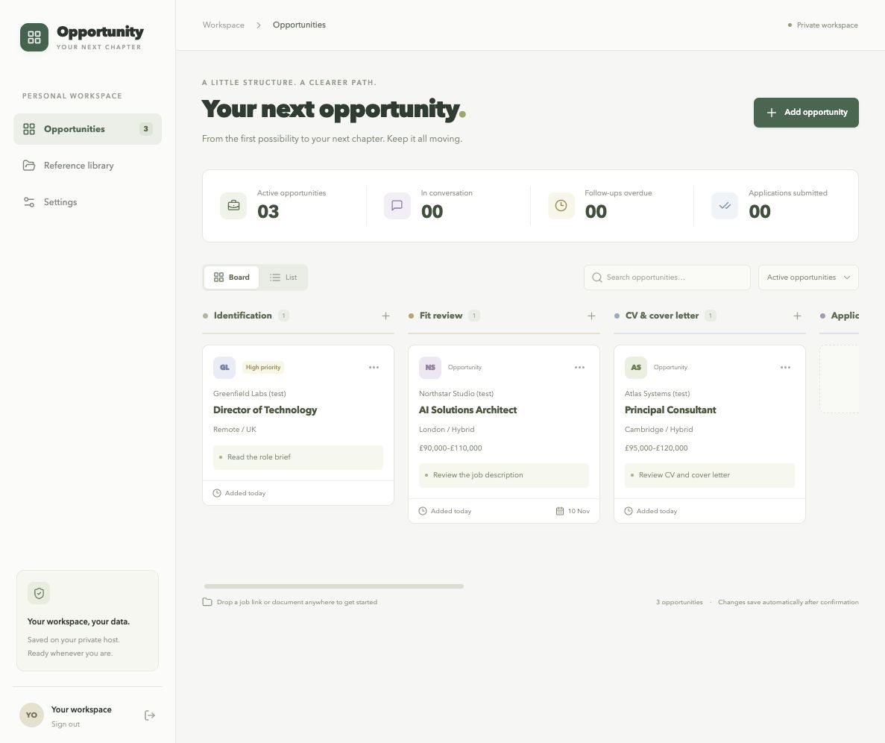

# Opportunity Knox

A private career workspace, from a saved job description to the final hiring decision. One service keeps opportunities, tasks, career evidence, and preferences available across your devices. Docker runs behind a small launcher.



## Start the board

Install Docker Desktop on a Mac, or Docker Engine with Compose on a Linux host. The launcher also uses Python 3. Then, from this repository:

```sh
./board start
```

On a Mac you can instead double-click `scripts/Start Board.command`. The launcher starts an installed Docker Desktop where possible, prepares persistent folders, builds the app, and opens the browser. The first build downloads dependencies and takes longer than later starts. Choose your board password on the first visit. The setup link contains a one-time setup credential; keep it private.

By default the browser address is `http://127.0.0.1:4318` and documents are stored in `~/OpportunityBoard`. The board starts empty. Any sample data is explicitly fictional and added only when requested in the app.

```sh
./board stop
./board start
./board restart
./board status
./board logs
```

Stopping preserves the database, settings, document files, and history. Closing a browser tab leaves the service running. Restarting applies pending host-folder changes. `scripts/Stop Board.command` is the Mac stop shortcut.

## Choose document locations

Choose an existing host folder on first launch if the default does not suit:

```sh
./board start --files "/path/to/Applications"
```

The choice is remembered. You can configure document, reference, and backup subfolders in the app's Settings. The folders shown there belong to the hosting machine. Browser uploads bring documents from your current device into that shared library.

An entirely new host folder can be requested in Settings, then applied with `./board restart` on the host. The launcher updates Docker's folder access automatically; no Compose or environment-file editing is required. Earlier document roots remain mounted at stable paths so existing attachments still open. An unavailable drive causes an error instead of silently replacing your files with an empty directory. Docker Desktop may ask for folder-sharing permission the first time a location is used.

The board database stays in the host's application-data directory, separately from the document folder. Default persistent state locations:

- Mac: `~/Library/Application Support/OpportunityBoard`
- Linux: `${XDG_DATA_HOME:-~/.local/share}/opportunity-board`

Keep this state directory when moving or upgrading the installation. It includes private credentials and generated launcher configuration. Document folders and state are outside the Git repository and container image. On Mac/Linux, the container runs with the launching user's UID and GID so saved files remain owned by that user.

## Use it across devices

The default address accepts connections from the host itself. For an existing private network/VPN, bind to that host's private IP:

```sh
./board start --bind 100.100.10.20 --no-open
```

Replace the example with the host's actual private address. Open `http://<host-private-address>:4318` from devices that can reach it, and sign in with the board password. Alternatively, `--bind 0.0.0.0` listens on all host IPv4 interfaces. Use the chosen host's private network/VPN or an authenticated HTTPS reverse proxy for remote access; do not publish the raw HTTP service to the public internet. Host/VPN provisioning remains specific to your installation.

The folder used with `--files` must exist on the hosting machine. A remote server cannot mount a Mac folder just because a browser there selected it. Use a host-mounted/synchronised folder, upload, or a future cloud-storage integration.

You can also choose a different port, remembered for future starts:

```sh
./board start --port 4319
```

## Workspace features

The initial manual workflow covers opportunity capture, dated stage history and corrections, notes, repeatable interviews and communications, document uploads/downloads, reference material, and configurable storage. The app tracks the documents used for an application; recording submission does not send anything to an employer.

Version 0.3 introduces the Opportunity Knox name and separate sidebar pages:

- **Dashboard:** statistics derived from saved opportunities and dated history, application activity, outcomes, tasks, and interview/action queues. Charts and records update after changes and periodic refreshes.
- **Opportunities:** searchable list for detailed application tracking.
- **Kanban board:** the eight-stage drag-and-drop board on its own page.
- **To-do list:** add, edit, complete, and reopen tasks; sort open tasks by due date with undated work last. Link a task to an opportunity when useful.
- **Career library:** a data dump for CVs, old JDs, certificates, project notes, achievements, interview notes, and other career material. Originals are stored; PDF, DOCX and text files can be prepared locally for Career Buddy retrieval.
- **Settings:** profile name/photo, themes, file locations, backups, and Career Buddy connections.

Choose Forest, Cappuccino, Ocean, or Midnight in Settings. The profile supports PNG, JPEG and WebP photos up to 2 MB. Preferences, profile and tasks persist in the database and private backups. Browser routes use `#/dashboard`, `#/opportunities`, `#/board`, `#/todos`, `#/library` and `#/settings`.

Existing installation directories, Docker project names and the `./board` command stay compatible. The default document directory remains `~/OpportunityBoard` and the Mac state directory remains `~/Library/Application Support/OpportunityBoard`.

Version 0.4 adds **Career Buddy**, an optional assistant configured in Settings. Choose OpenAI, Claude, Gemini, Ollama, or a custom OpenAI-compatible API, add a key where required, choose a discovered model (or enter its ID manually), and test the connection before or after saving. In an opportunity, open the Career Buddy tab to chat, review proposed updates, ask about fit/salary/skills, and draft a CV or cover letter. Reviewable Word drafts can be saved as new versions in Documents. See [docs/CAREER_BUDDY.md](docs/CAREER_BUDDY.md) for setup, source coverage, privacy and current limits. Job-link lookup and manual tracking still work without an AI provider. The full agreed direction is recorded in [docs/PLAN.md](docs/PLAN.md), with implementation interfaces in [docs/CONTRACT.md](docs/CONTRACT.md).

Record export is JSON with a document manifest; it is not a full portable document archive. The backup action creates a private database snapshot and copies managed document files into a snapshot directory under the backup subfolder selected in Settings, within the current document root. A guided restore/import and cloud-document connectors are subsequent work. Check a backup's contents before relying on it as your only recovery copy.

## Look up a job link

Add an opportunity, paste its listing URL, and choose **Fetch job details**. Dropping a job link onto the board opens a draft and starts lookup. Review the extracted company, role, location, salary, employment type, closing date, reference, contact and description before saving. Missing information stays blank. Existing opportunities can look up their saved link and preview details to fill empty fields while preserving your edits.

Lookup first reads published `JobPosting` structured data and otherwise extracts the visible job content, including public LinkedIn listings. It does not require an AI key, send reference CVs, or submit an application. The draft shows its source and retrieval time. A listing which requires sign-in, blocks requests, needs JavaScript to reveal its content, or links directly to a PDF may need pasted JD text or an uploaded file instead.

The host retrieves public HTTP(S) pages only. Private-network targets and unsafe redirects are rejected; downloads have time and size limits. These restrictions also apply when the browser itself could access a local/private site.

## Development

Node.js 24 or later is required for the built-in SQLite API. Install dependencies, start the API, and start the frontend development server:

```sh
npm ci
npm run dev:server
# In a second terminal:
npm run dev
```

For a production frontend served by the API:

```sh
npm run build
npm start
```

Environment variables for development or direct hosting:

| Variable | Purpose |
| --- | --- |
| `BOARD_DATA_DIR` | Persistent database/settings directory |
| `BOARD_FILES_DIR` | Current document root |
| `BOARD_HOST_FILES_DIR` | Host path shown in Settings |
| `BOARD_DOCUMENT_ROOTS` | JSON list of available current and retained document roots |
| `BOARD_SETUP_TOKEN` | Initial password-setup credential; supplied automatically by the launcher |
| `HOST` / `PORT` | API bind address and port |

Run checks with:

```sh
npm run build
npm test
python3 -m unittest discover -s tests -p test_launcher.py
```

The launcher's tests use temporary folders and mocked commands. They do not start Docker or read career documents. Real application data, reference CVs, credentials, and backups should never be committed.
